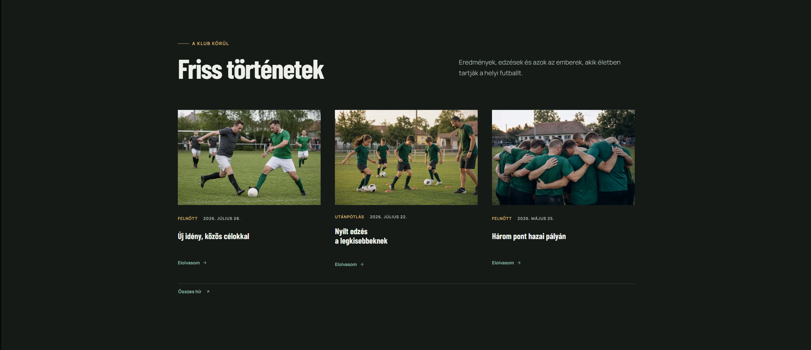
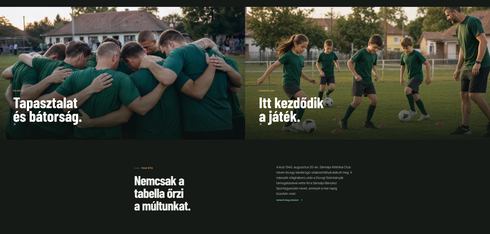
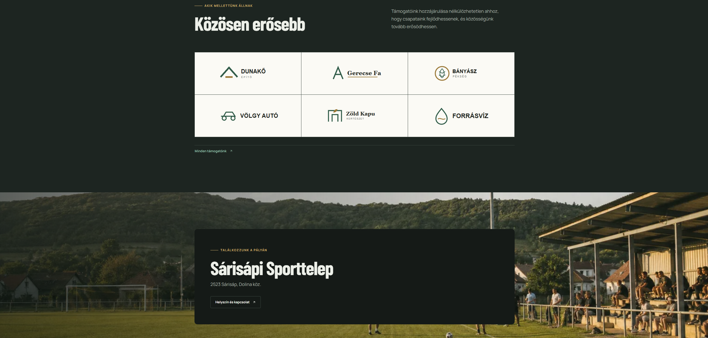
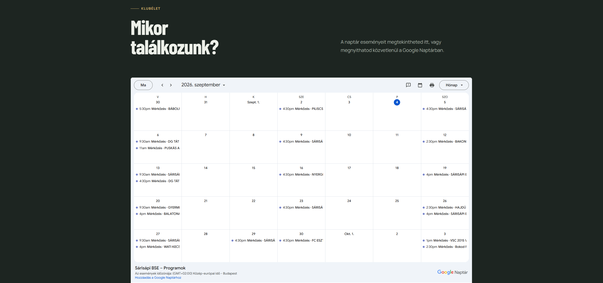
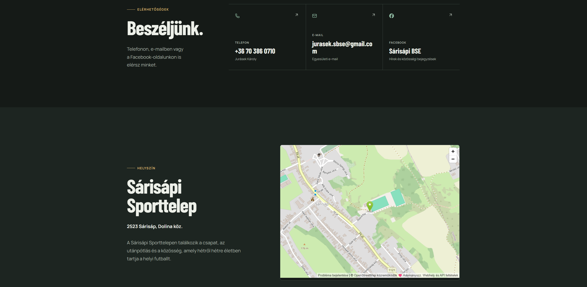

# Sárisápi BSE

A responsive football club website for Sárisápi Bányász Sport Egyesület, bringing together club news, five team profiles, match data, events, sponsors, and club documents.

## Technical highlights

- **Nuxt 4, Vue 3, and TypeScript** with server-side rendering and Nitro API routes.
- **MLSZ integration:** server-side scraping of match schedules and player rosters using Cheerio, with one-hour caching and a fallback to previously fetched data during temporary outages.
- **Google Calendar integration:** an embedded club calendar with hourly match synchronization through the Google Calendar API, authenticated with a service account. Updates preserve manually added club events.
- **Netlify auto-deploy:** Git-connected builds and deployments, plus a scheduled serverless function for calendar synchronization.
- **Content management:** Markdown news and YAML club data managed through Nuxt Content with Zod schema validation.
- **Responsive UI:** light and dark themes, optimized images, generated sitemap, and configurable search indexing.
- **Quality checks:** ESLint, TypeScript checks, and Vitest tests, available together with a production build via `npm run check`.

See [Development and deployment](dev.md) for setup and [Content management](operator.md) for editing instructions.

## Screenshots

